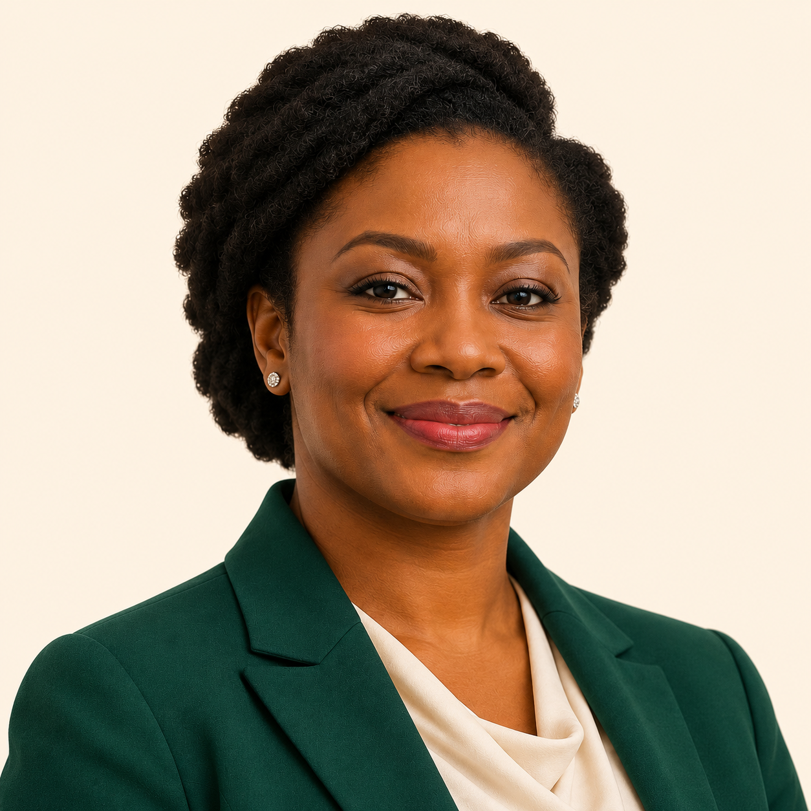
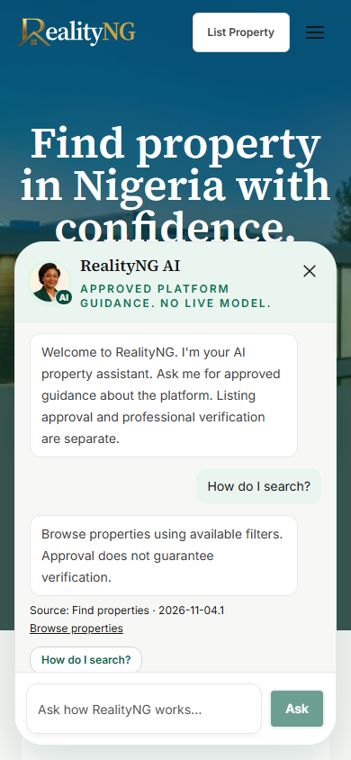
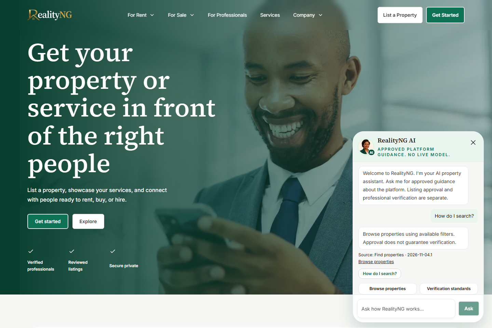

# Approved RealityNG AI concierge — integration review

The CTO approved the realistic female concierge direction on 4 November 2026. The new standalone portrait preserves the approved fictional character's face, natural hair and emerald/cream clothing, with face and shoulders framed for small circular display. The original concept board is retained below as provenance, not as a proposed replacement for RealityNG's logo or page layout.

## Rights and provenance

The portrait was created with the built-in image-generation tool from an original fictional concept generated in the same authorized session. No stock photograph, real-person reference or external avatar subscription was used. Original tool output: exec-64f99f96-d671-4c02-804c-b3505a640b2a.png. The source input was concierge-concept.png in this folder. Neither a paid API/CLI fallback nor automatic audio was used.

OpenAI's current Terms of Use assign its output rights to the user to the extent permitted by law; the Services Agreement similarly assigns output rights to the customer. This supports commercial website use subject to applicable terms and third-party rights. It does not guarantee exclusive copyright, uniqueness or exhaustive third-party clearance. The generated wordmark on the original concept board is not integrated; existing RealityNG branding is preserved. The avatar is explicitly labelled AI and is not represented as a real employee.

Sources checked 4 November 2026:
- https://openai.com/policies/row-terms-of-use/ (Content)
- https://openai.com/policies/services-agreement/ (4. Customer Content)

## Implementation boundary

Stacked on frontend PR #48. No merges or production deployments are authorized. The three reviewed functional heads remain unchanged.

- Existing bottom-right launcher and mobile navigation offsets remain intact.
- The local portrait uses the existing Next.js Image optimizer and responsive sizes, not a third-party service. The source image is not embedded at full resolution in the widget.
- Portrait and AI badge are decorative; the launcher/region identify the assistant as AI for assistive technology.
- Only a subtle motion-safe hover scale is added. Reduced motion disables the transition. No simulated speech or microphone behavior.
- Image load failures fall back to the existing orb at the same dimensions.
- Authentication, knowledge retrieval, conversation and payment behavior are unchanged.

## Pre-integration verification

An isolated preview passed 10 cases: 320, 375, 390, 768 and 1440px, each with reduced motion and normal motion. Checked loaded portrait, panel boundaries, keyboard open, Escape, restored focus and zero axe violations. The preview did not connect to any backend.

Actual application validation adds portrait loading/reduced-motion checks, normal hover behavior, optimized response-size checks and five viewport widths to the existing assistant suite. Full final CI and preview status are recorded on this PR. Artwork integration must still receive final release authorization.

Source portrait SHA-256: 63ee88ae96d0a1c97fbbd6a259cf8e99d30aabb451509c5680b4a222022c694e

Local integration validation: 326 unit tests, TypeScript, full ESLint and production build passed. Twenty actual-app browser cases passed across five widths, including zero scoped axe violations, normal/reduced motion, focus/Escape, source citations, authenticated guidance and optimized portrait delivery below 100 KB. No production data or real accounts were used.

