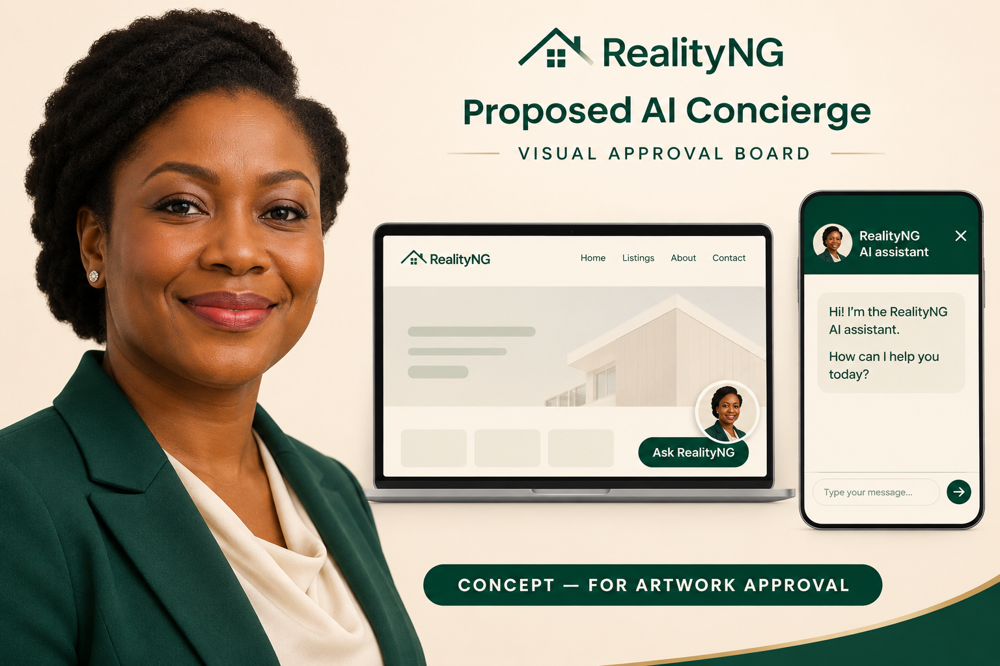

# Female AI concierge — artwork approval only

Status: awaiting CTO visual approval. This PR contains no application integration, public asset, import, dependency, subscription, audio or runtime change. The current orb stays in place.

Direction: original fictional adult Nigerian woman, warm professional expression, natural hair, emerald blazer and cream blouse. A compact bottom-right portrait launcher retains the existing interface and mobile navigation offset. Label it RealityNG AI assistant so the portrait is not mistaken for a human operator.

The board's surrounding website, wordmark and screen layouts are illustrative only. They are not proposed replacements for the existing RealityNG logo, website or chat layout. Review the portrait direction and small-scale legibility. Any approved integration will reuse the existing application and real brand assets.

After approval: create an optimized portrait asset with an image fallback, verify 320/390px phones and desktop, retain keyboard labels and focus behavior, respect safe areas and reduced motion. Use a subtle hover/entrance effect and an honest processing indicator. No continuous face animation, automatic audio or paid avatar service.

Generated with the built-in image-generation tool; no API/CLI fallback or external subscription. Original output retained outside the repository. Prompt:

> Create a polished visual approval board for RealityNG's proposed AI concierge, NOT an implemented application. Original fictional adult Nigerian woman about 30-40, realistic natural skin texture, warm confident expression, neat natural hair, professional emerald blazer and cream blouse, tasteful simple stud earrings. Friendly, capable professional, editorial portrait quality, no resemblance to a celebrity. Main large head-and-shoulders portrait on warm pale background; beside it show two compact UI placement mockups using the SAME portrait: desktop bottom-right circular portrait launcher with label Ask RealityNG, and a narrow mobile chat panel with heading RealityNG AI assistant, clear close control and small portrait, emerald and ivory palette. Add small clear caption CONCEPT — FOR ARTWORK APPROVAL. The portrait must be recognizable at small size. Calm premium visual style, realistic face, no robot, no microphone, no talking or voice imagery, no futuristic holograms, no property verification or payment claims. Keep readable sparse UI text, generous whitespace. This is a preview board only.
