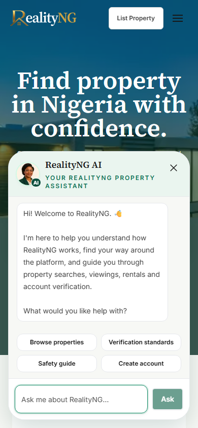
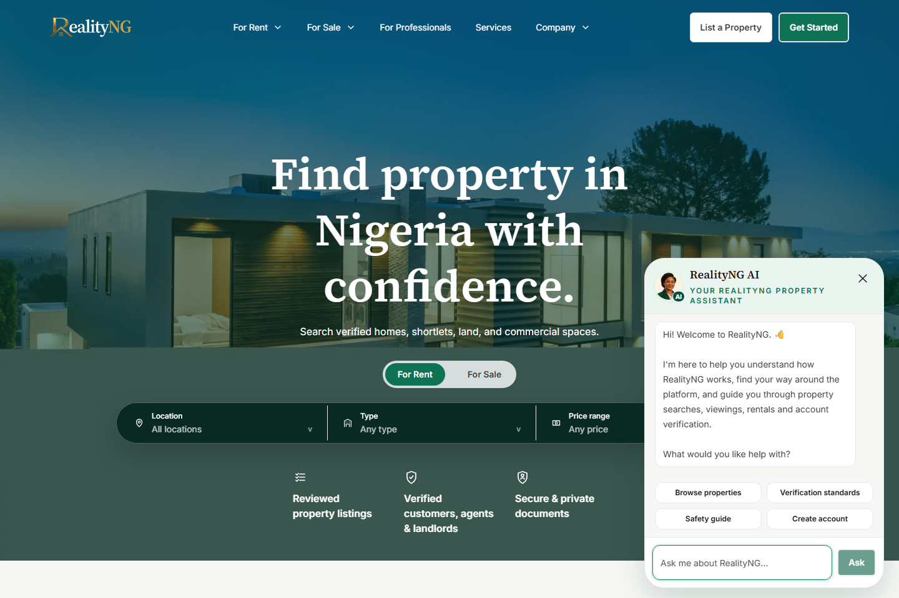
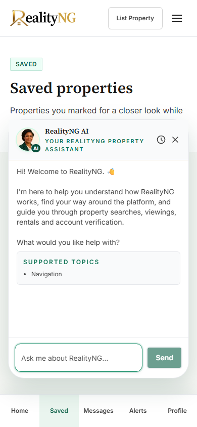
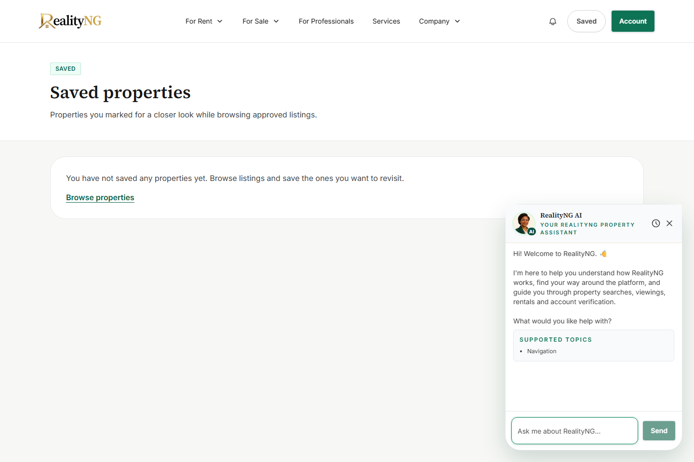

# AI Concierge copy review

Customer-facing copy only; no merge or production deployment authorized.

The shared UI copy uses the approved title, subtitle, exact welcome paragraphs and placeholder. Existing suggestions, links, avatar artwork, authentication, request flags and APIs are unchanged. A presentation-only compatibility helper rewords the existing legacy greeting, search, navigation and unsupported strings, including saved history; it never classifies questions or mutates response objects. User text and unfamiliar replies remain unchanged. Backend payloads/history retain their original content.

Screenshots come from the local production build with isolated current-contract API fixtures, no production accounts or private data. The fixture leaves optional suggestions empty; tests separately verify configured suggested questions are preserved. Internal provider mode remains demo and knowledge is disabled in the release fixtures. Additional knowledge-enabled and unavailable cases retain their existing coverage; no feature is activated.

| Interface | Mobile 390px | Desktop 1440px |
|---|---|---|
| Public |  |  |
| Authenticated |  |  |

Validation: 366 unit tests; 35 assistant browser cases at 320/375/390/768/1440, including B2C, B2B, authenticated interfaces, unsupported replies, navigation, axe checks, keyboard focus and reduced motion. TypeScript, ESLint, production build and required production audit passed locally. Production audit retains five inherited moderate findings; no dependency changes or broad security remediation are included. Final required CI and preview status are reported on the PR.
